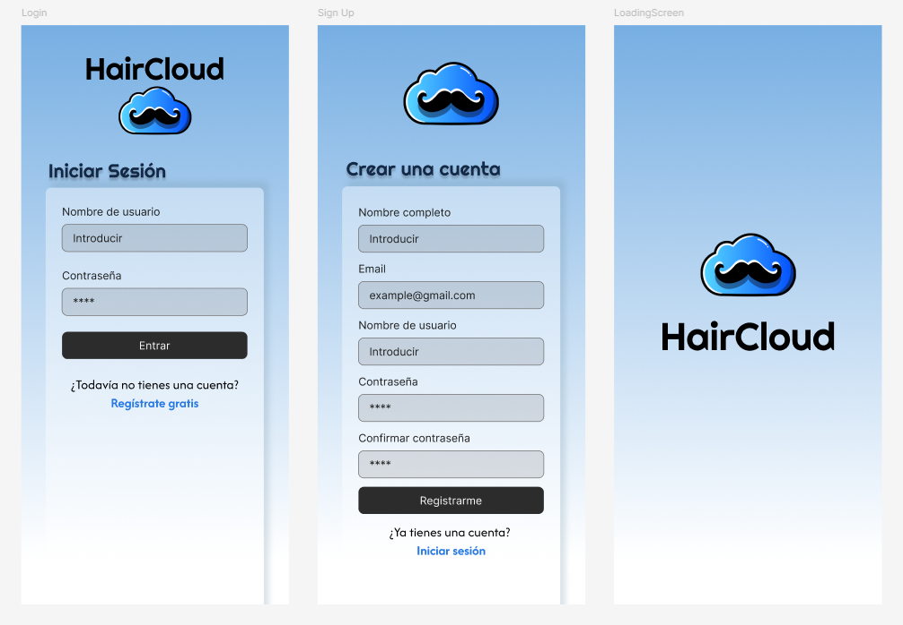
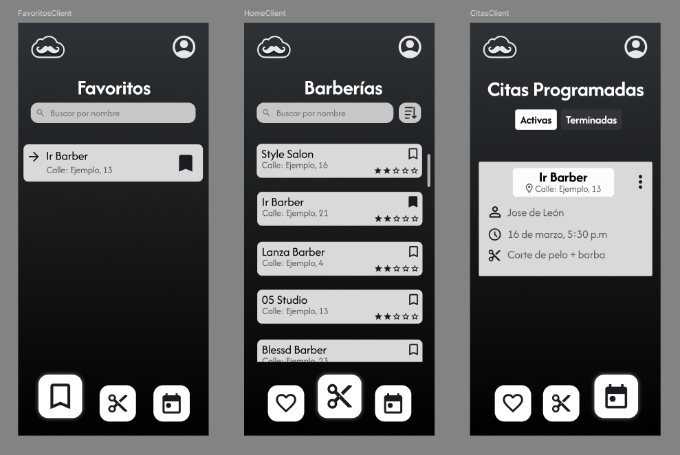
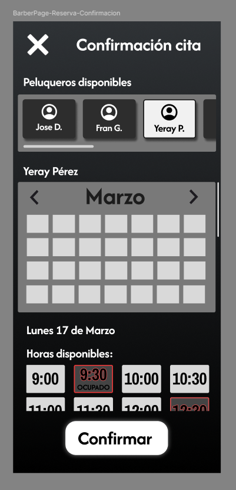

<div align="center">


# HairCloud

### Gestión de citas y operaciones para peluquerías desde Android

**Proyecto Full Stack · Aplicación Android + API REST + PostgreSQL**


[](#estado-del-proyecto)
[](#tecnologías)
[](https://github.com/fmoorenoo/HairCloud)

</div>

---

## Sobre el proyecto

**HairCloud** es una aplicación Android desarrollada como proyecto final de formación en desarrollo de aplicaciones. Su objetivo es facilitar la gestión de citas de peluquerías y ofrecer experiencias diferenciadas para **clientes** y **profesionales**.

El repositorio reúne una interfaz móvil construida con **Kotlin y Jetpack Compose**, un backend **Python/Flask** con endpoints REST y una base de datos **PostgreSQL**.

> **Estado:** nacido como proyecto de fin de ciclo y consolidado en la versión 2.0: API REST versionada con autenticación y autorización en servidor, reglas de negocio validadas en backend, migraciones de base de datos y batería de tests automatizados. Ver [docs/AUDITORIA.md](docs/AUDITORIA.md).

## Funcionalidades

| Para clientes | Para peluquerías y profesionales |
| --- | --- |
| Registro, acceso y recuperación de cuenta | Perfil y administración de la peluquería |
| Consulta de peluquerías y servicios | Configuración de servicios y profesionales |
| Reserva y consulta de citas | Calendario y gestión de citas |
| Favoritos y perfiles | Pantallas de informes y estadísticas |
| Consulta de reseñas | Gestión y consulta de reseñas |

El código también incluye utilidades para notificaciones y correos relacionados con el proceso de reserva.

## Tecnologías

| Capa | Herramientas |
| --- | --- |
| **Aplicación móvil** | Kotlin, Jetpack Compose, Material 3 |
| **Arquitectura Android** | ViewModel, Repository Pattern, Navigation Compose |
| **Comunicación** | Retrofit 2.11, OkHttp 4.12 (interceptor de autenticación + renovación automática de sesión) |
| **Almacenamiento seguro** | DataStore + cifrado AES-GCM con clave del Android Keystore |
| **Backend** | Python 3.12, Flask 3, Pydantic 2 (validación), Waitress (servidor WSGI) |
| **Autenticación** | JWT de corta duración + refresh tokens rotatorios, bcrypt, Flask-Limiter |
| **Base de datos** | PostgreSQL 17, psycopg 3 con pool de conexiones, migraciones SQL versionadas |
| **Correo** | SMTP con plantillas Jinja2 autoescapadas |
| **Calidad** | pytest contra PostgreSQL real, tests JVM, GitHub Actions |

## Arquitectura

```text
HairCloud/
├── frontend/                       # Proyecto Android
│   └── app/src/main/java/com/haircloud/
│       ├── data/                   # ApiClient (auth + refresh), ApiService, SessionManager
│       │   ├── model/              # DTOs de la API
│       │   ├── repository/         # Acceso a la API (Result<T>)
│       │   └── storage/            # Sesión cifrada con Android Keystore
│       ├── navigation/             # Navegación entre pantallas
│       ├── screens/                # Interfaces de clientes y profesionales
│       ├── viewmodel/              # Estado y lógica de presentación
│       └── utils/                  # Utilidades compartidas
├── backend/
│   ├── app/
│   │   ├── api/                    # Blueprints REST bajo /api/v1
│   │   ├── security/               # Tokens, control de acceso, contraseñas, auditoría
│   │   ├── services/               # Reglas de negocio (citas, disponibilidad, stats, correo)
│   │   ├── templates/email/        # Plantillas de correo (HTML + texto)
│   │   ├── schemas.py              # Validación de entrada (Pydantic)
│   │   ├── serializers.py          # Representación JSON de cada recurso
│   │   ├── db.py                   # Pool de conexiones y transacciones
│   │   └── cli.py                  # Migraciones, mantenimiento, alta de admin, datos demo
│   ├── migrations/                 # 0001 esquema original · 0002 consolidación
│   ├── tests/                      # pytest contra PostgreSQL
│   ├── wsgi.py                     # Punto de entrada de producción
│   └── app.py                      # Servidor de desarrollo
├── docs/AUDITORIA.md               # Auditoría y cambios de la versión 2.0
└── anteproyecto/                   # Análisis, diagramas y diseños
```

**Principios de la API:**

- La identidad del usuario sale **siempre del token**, nunca de un id en la URL (`/me/...`).
- Cada operación comprueba el **rol y el local** del usuario (cliente, peluquero, semiadmin, admin).
- Las reglas de negocio (horarios, solapes, cancelaciones, transiciones de estado, límites) se aplican en el **servidor**; la base de datos añade restricciones como red de seguridad (p. ej. exclusión de citas solapadas).
- Errores homogéneos: `{"error": "mensaje", "code": "codigo"}` sin detalles internos.

### Roles y permisos

| Acción | Cliente | Peluquero | Semiadmin | Admin |
| --- | :---: | :---: | :---: | :---: |
| Reservar / cancelar sus citas (hasta 30 min antes) | ✔ | | | |
| Reseñar locales (máx. 3 por local) y borrar las suyas | ✔ | | | |
| Ver y gestionar su agenda, horario y estadísticas | | ✔ | ✔ | ✔ |
| Ver agenda de compañeros, moderar reseñas, gestionar servicios | | | ✔ | ✔ |
| Editar el local, dar de alta/baja personal, cambiar roles | | | | ✔ |

## Diseño y capturas

Las imágenes disponibles en el repositorio corresponden a **propuestas de interfaz y material de diseño** del anteproyecto, no necesariamente a capturas de la aplicación en ejecución.

<div align="center">
  
</div>

| Vista para clientes | Flujo de reserva |
| :---: | :---: |
|  |  |

**Documentación adicional:** [Anteproyecto](anteproyecto/anteproyectoHairCloud.pdf) · [Diseños en PDF](anteproyecto/figmaHairCloud.pdf) · [Diagrama de datos](anteproyecto/media/diagram_image.png)

## Instalación y configuración

### Backend

Requisitos: Python 3.12 y PostgreSQL 15+ (con la extensión `btree_gist`, incluida en PostgreSQL).

```bash
cd backend
python -m venv .venv
.venv\Scripts\activate            # Linux/macOS: source .venv/bin/activate
pip install -r requirements-dev.txt
copy .env.example .env             # Linux/macOS: cp .env.example .env  -> rellena los valores
```

Crea un usuario de base de datos **sin privilegios de superusuario** y una base de datos de su propiedad:

```sql
CREATE ROLE haircloud_app LOGIN PASSWORD 'una-clave-larga';
CREATE DATABASE "HairCloud" OWNER haircloud_app;
CREATE DATABASE haircloud_test OWNER haircloud_app;   -- para los tests
```

```bash
flask --app wsgi db-upgrade        # aplica las migraciones (también sobre una BD antigua de HairCloud)
flask --app wsgi seed-demo         # opcional: datos ficticios de desarrollo
flask --app wsgi create-admin      # alta de un local y su administrador
python app.py                      # servidor de desarrollo en 127.0.0.1:5000 (--lan para un móvil físico)
python -m pytest                   # tests
```

En producción:

```bash
waitress-serve --listen=0.0.0.0:5000 wsgi:app      # detrás de un proxy HTTPS (TRUSTED_PROXIES=1)
flask --app wsgi maintenance                         # programar a diario (cron / Programador de tareas)
```

> `APP_ENV` es `production` por defecto: sin `SECRET_KEY`/`JWT_SECRET` (≥ 32 caracteres) la API no arranca. Con varios procesos, usa Redis para el rate limiting (`RATELIMIT_STORAGE_URI=redis://...`).

### Android

1. Abre `frontend/` en Android Studio (JDK 17).
2. La URL de la API se define en `frontend/local.properties` (no versionado):

```properties
# Emulador (valor por defecto): http://10.0.2.2:5000/api/v1/
haircloud.apiBaseUrl.debug=http://192.168.1.50:5000/api/v1/
# Release: obligatorio HTTPS
haircloud.apiBaseUrl.release=https://api.tudominio.com/api/v1/
```

3. Si usas un móvil físico en debug, añade su IP del PC a `app/src/debug/res/xml/network_security_config.xml` (el tráfico HTTP en claro solo se permite hacia hosts de desarrollo y nunca en release).
4. `./gradlew :app:testDebugUnitTest :app:assembleDebug` · el build release activa R8.

## Proyecto de ejemplo

HairCloud es un **proyecto de ejemplo y portfolio**: no está desplegado ni se va a usar en producción.

- Los datos de la base de datos son **datos de prueba**, no de clientes reales.
- El volcado `haircloud_backup.sql` se ha retirado del repositorio y se sustituye por las migraciones (`flask --app wsgi db-upgrade`) y los datos ficticios de `flask --app wsgi seed-demo`. En el historial de git queda una copia antigua con esos mismos datos de prueba; se mantiene a propósito.
- Las medidas de seguridad (autenticación, permisos, HTTPS, rate limiting...) están implementadas como lo estarían en un producto real, pero no se ha hecho un despliegue ni una auditoría externa.

## Estado del proyecto

**Versión 2.0 (consolidada).** Backend con 41 tests automatizados contra PostgreSQL, app Android con tests JVM, compilación debug y release verificadas y un test de contrato app↔API sobre un servidor real. La interfaz se mantiene igual que en la versión académica. Detalle de la auditoría y los cambios en [docs/AUDITORIA.md](docs/AUDITORIA.md).

## Autor

**Fernando Montelongo Moreno** · Full Stack Developer · DAM + DAW

[](https://github.com/fmoorenoo)
[](https://www.linkedin.com/in/fernando-montelongo/)

---

<div align="center">
  <sub>HairCloud · Proyecto de desarrollo multiplataforma · Fernando Montelongo Moreno</sub>
</div>
